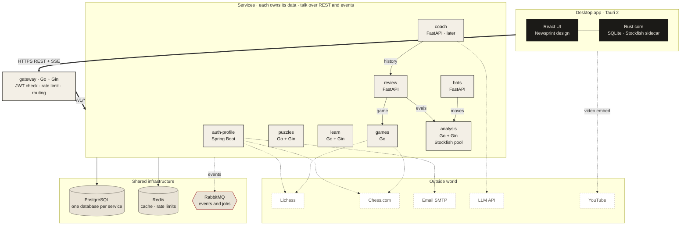

# System architecture

Everything the product is made of. The desktop app talks only to the gateway. Services own their data, call each other over REST for questions and use RabbitMQ events for things that happened.
Legend: black = client, cream = service, grey cylinder = data store, red outline = message broker, dashed = outside world.

