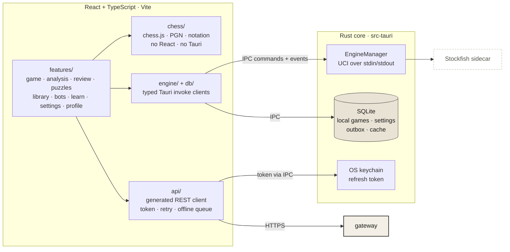
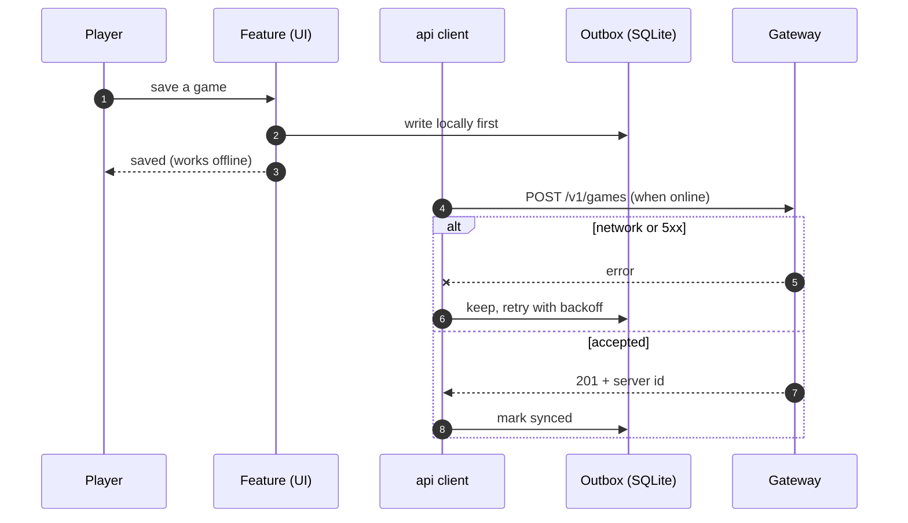

# Desktop client

Local-first: the board, local games, local engine analysis, settings and the local profile all work with no network. Everything shared (review, puzzles, library, bots, accounts) goes through the gateway.
Owner milestones: M0 to M3 (local core), then each feature as its service lands.

