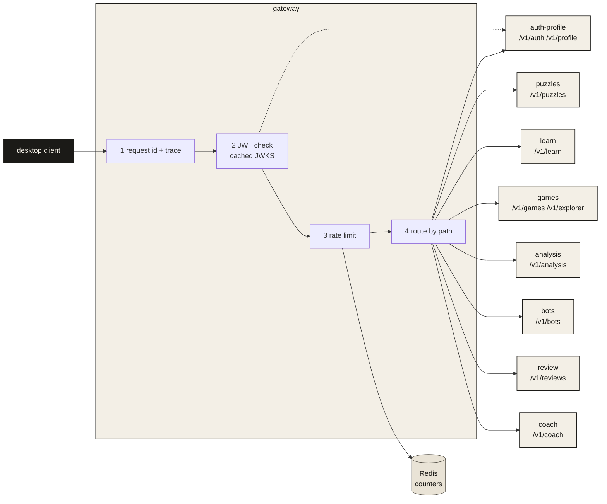

# gateway (Go + Gin)

Single public entry. No business logic and no database.
Does: route /v1/<service>/** · validate the JWT (JWKS from auth-profile) · rate limit per user and IP (Redis) · CORS · request id and trace headers · merge OpenAPI docs.
Port 8080. Milestone: P2.

