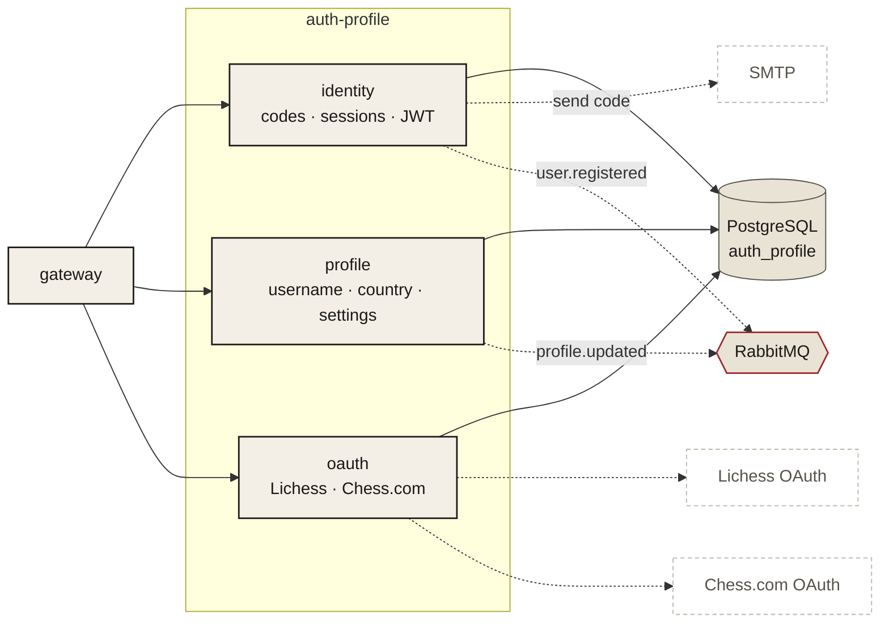
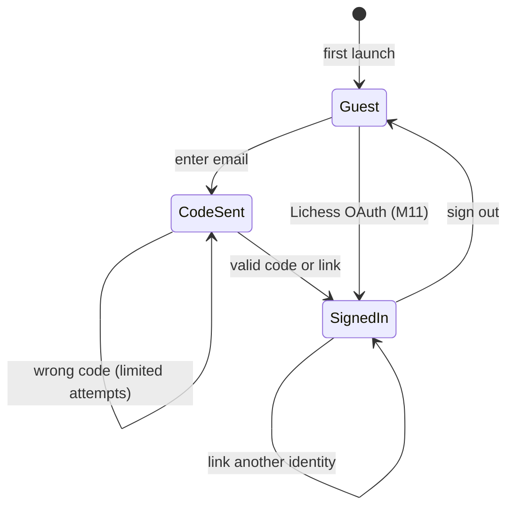

# auth-profile (Spring Boot)

Who you are. Email code or link sign-in (no password), guest tokens, Lichess and Chess.com account linking, JWT issuing, and the player profile (username, country, settings, themes).
Owns: users, identities, sessions (refresh tokens), email codes, profiles, synced settings.
Events out: user.registered, profile.updated. Milestones: P2 (email, guest, profile), M11 (Lichess and Chess.com).

