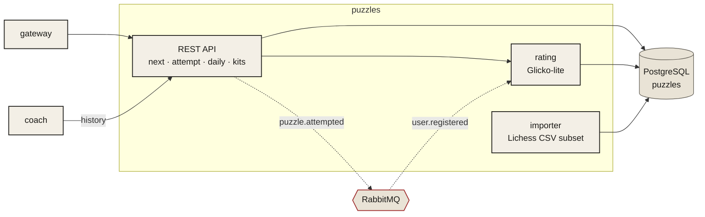
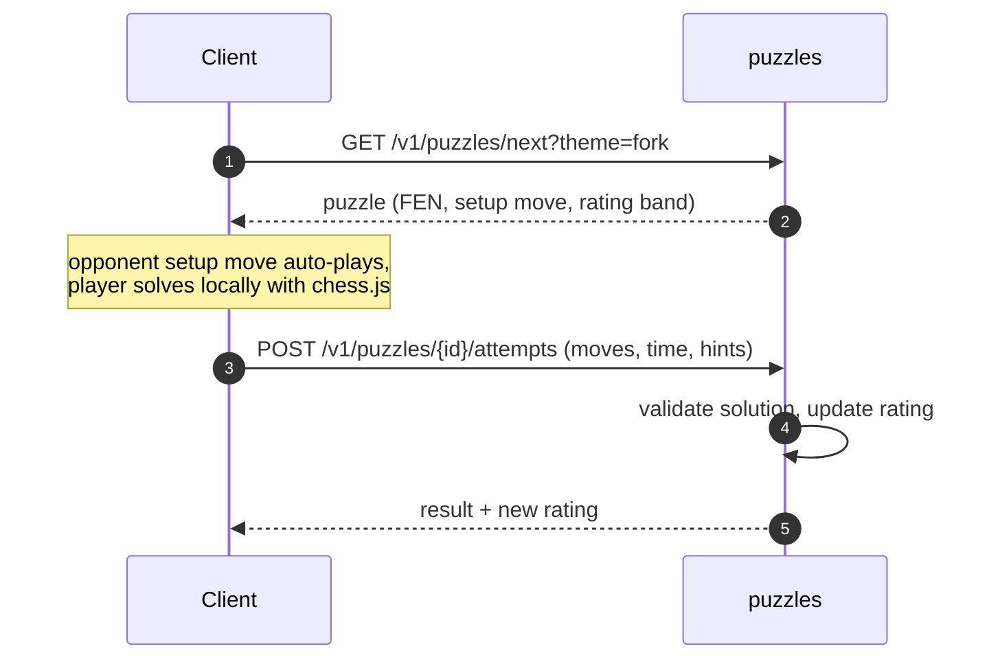

# puzzles (Go + Gin)

Tactics training. Serves puzzles by rating and theme, checks attempts, keeps the player's puzzle rating, picks the daily puzzle, and holds kits (and kids puzzles in M15).
Owns: puzzles (imported from the Lichess subset), kits, attempts, puzzle ratings.
Events in: user.registered. Events out: puzzle.attempted. Milestone: M6.

