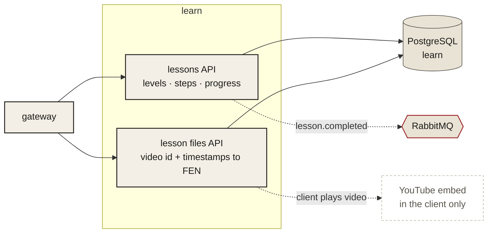

# learn (Go + Gin)

Lessons and YouTube lesson files. Serves lessons by level, tracks progress, and stores lesson files that link video timestamps to board positions (video id + list of time, FEN, note).
Owns: lessons, steps, progress, lesson files.
Events out: lesson.completed. Milestones: M13 (Learn), M14 (YouTube mode).

