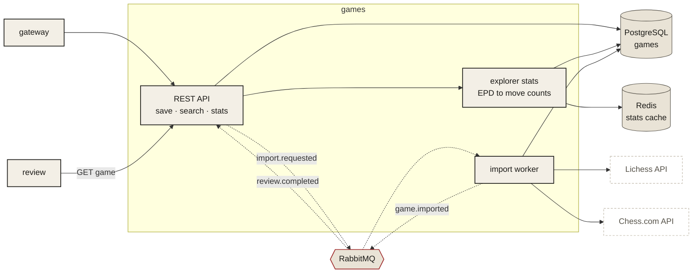
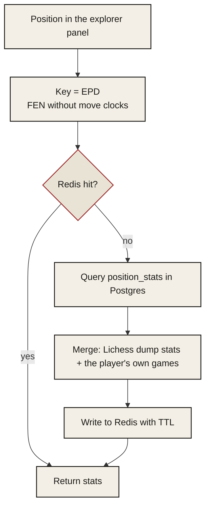

# games (Go)

The games database. Stores games (PGN plus indexed fields), imports games by username from Chess.com and Lichess, searches them, and computes opening-explorer statistics (most played moves per position).
Owns: games, import jobs, position stats (key = EPD).
Events in: import.requested, review.completed. Events out: game.saved, game.imported. Milestones: M8 (games and import), M12 (explorer).

