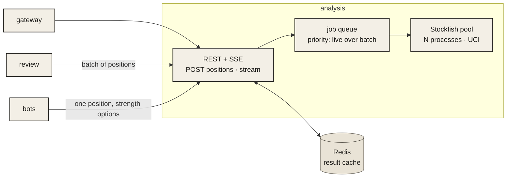
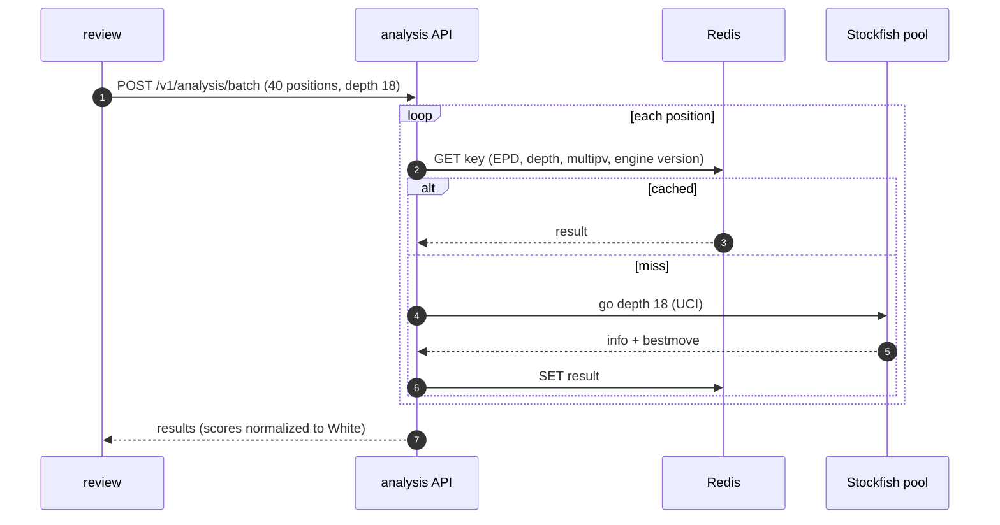

# analysis (Go + Gin)

A pool of Stockfish processes behind an API. Answers "evaluate this position" for other services and for clients without a local engine. Caches results per position so the same position is never analyzed twice at the same depth.
Owns: nothing permanent. Redis cache key: EPD + depth + multipv + engine version.
Called by: review, bots, (coach, mobile later). Milestone: M4.

