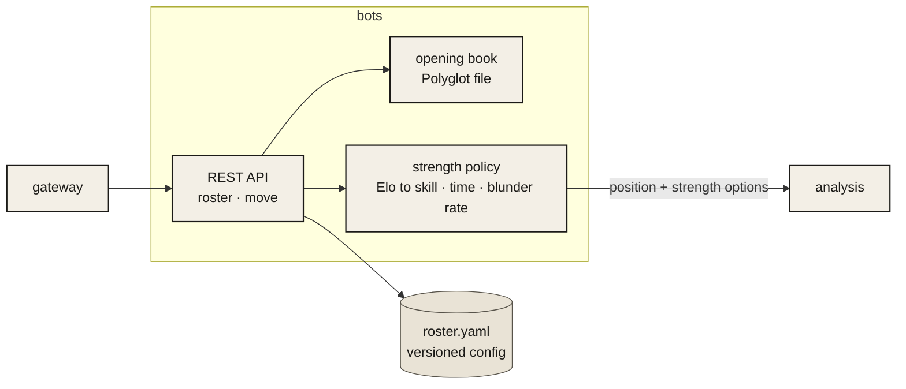
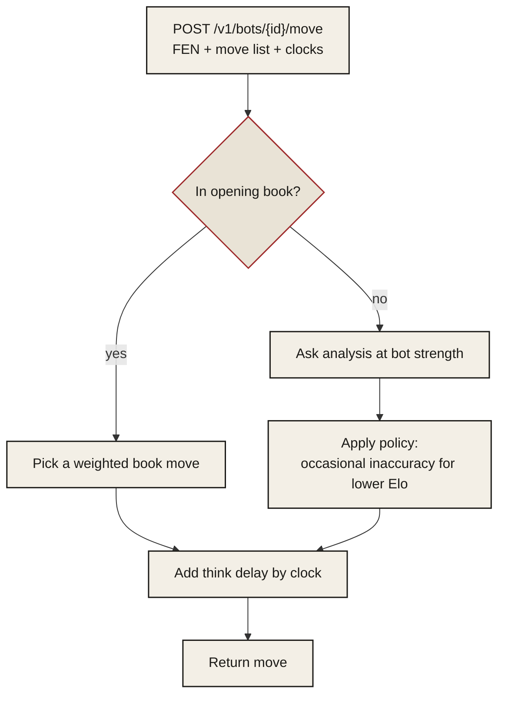

# bots (FastAPI)

Practice opponents. A roster of named bots with a target strength and style. Given a position and the clocks, returns the bot's move. Uses an opening book first, then asks analysis for a move at the bot's strength, and adds a human-like delay.
Owns: roster (versioned config), opening books. No database in the first version; game state lives in the client and the games service.
Milestone: M10.

