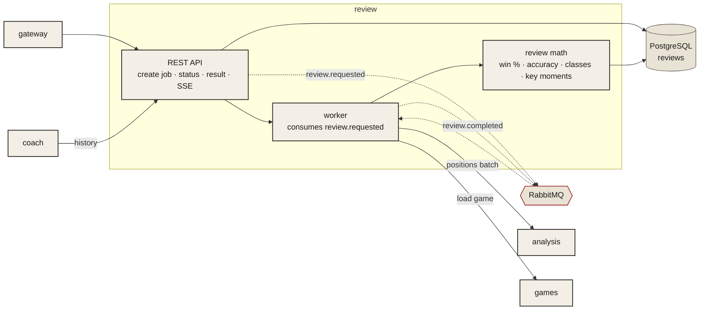
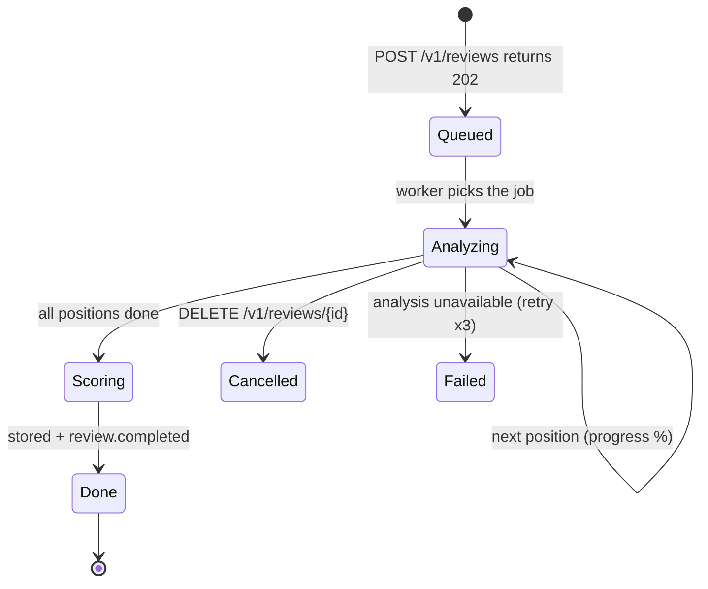

# review (FastAPI)

Post-game review. Takes a PGN or a game id, asks analysis for every position, converts evaluations to win probability, classifies each move (inaccuracy, mistake, blunder), computes accuracy per side and picks key moments. Runs as an asynchronous job with progress.
Owns: reviews, review jobs. Events in: review.requested. Events out: review.completed.
Milestone: M5.

