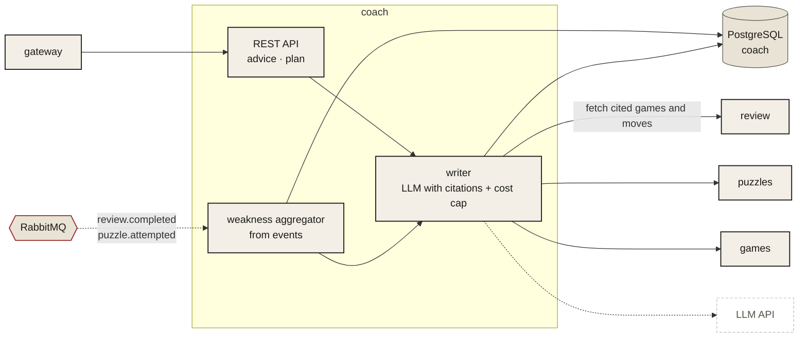

# coach (FastAPI, later)

Personalized advice. Builds a profile of the player's recurring mistakes from reviews, puzzles and games, then writes a short weekly plan and explanations. Stockfish facts come from the other services; the language model only explains, and every claim must cite a game and a move.
Owns: weakness stats, advice, weekly plans, usage and cost counters. Events in: review.completed, puzzle.attempted.
Milestone: M17.

