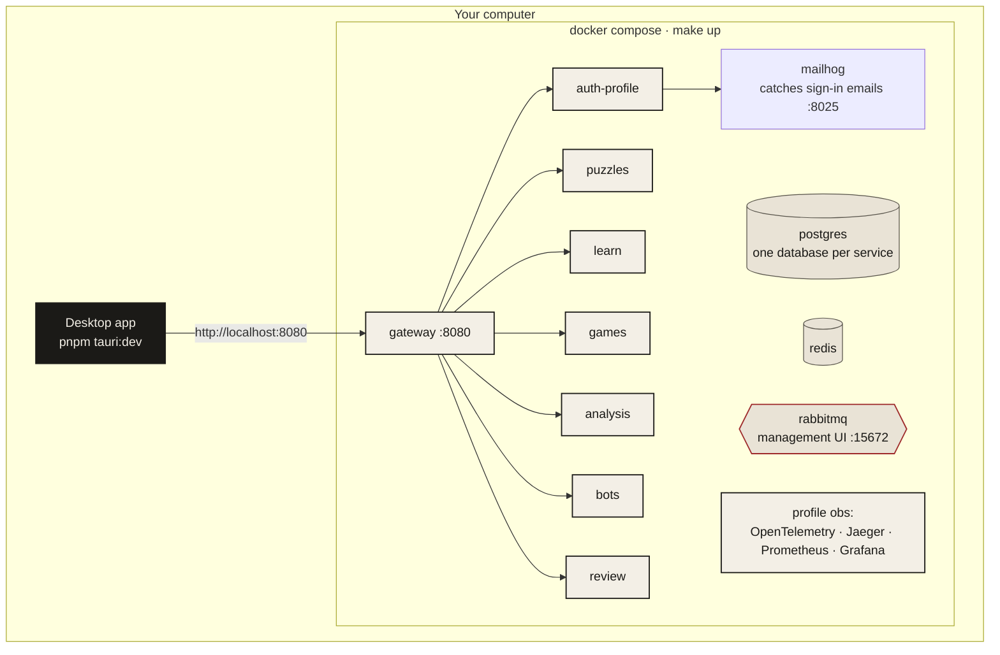

# Local development and delivery

```mermaid
flowchart LR
  classDef svc fill:#F3EFE6,stroke:#1B1A17,stroke-width:1.5px,color:#1B1A17
  classDef db fill:#E9E3D6,stroke:#57534A,color:#1B1A17
  classDef mq fill:#E9E3D6,stroke:#9E2A2B,stroke-width:1.5px,color:#1B1A17
  classDef ext fill:#FFFFFF,stroke:#BDB5A6,stroke-dasharray:4 3,color:#57534A
  classDef cli fill:#1B1A17,stroke:#1B1A17,color:#F3EFE6
  P["git push"] --> F["CI: detect changed paths"]
  F --> T["per-service: lint · unit tests · contract check"]
  T --> I["build image"]
  I --> S["compose smoke test<br/>all services + health checks"]
  S --> R["push image to registry"]
  R --> ST["deploy to staging"]
  ST --> PR["manual approval"]
  PR --> PROD["deploy to production"]
  class P,F,T,I,S,R,ST,PR,PROD svc
```

How the system runs on your machine (Docker Compose) and how a change reaches production (v2.0). Everything backend runs in Docker: `make up` starts infra and services, `make watch` rebuilds on change, `make check-svc S=<name>` tests inside the service's toolchain image. Only the desktop app runs on the host.

